<a href="https://shubham-kumar-singh.vercel.app">
  <picture>
    <source media="(prefers-color-scheme: dark)" srcset="./assets/header-dark.svg">
    
  </picture>
</a>

  <a href="https://shubham-kumar-singh.vercel.app"><picture><source media="(prefers-color-scheme: dark)" srcset="./assets/btn-portfolio-dark.svg"></picture></a>
  <a href="https://portfolio-assistant-iota.vercel.app"><picture><source media="(prefers-color-scheme: dark)" srcset="./assets/btn-assistant-dark.svg"></picture></a>
  <a href="https://www.linkedin.com/in/shubham-kumar-singh-00236a191"><picture><source media="(prefers-color-scheme: dark)" srcset="./assets/btn-linkedin-dark.svg"></picture></a>
  <a href="mailto:shubhamsingh90390@gmail.com"><picture><source media="(prefers-color-scheme: dark)" srcset="./assets/btn-email-dark.svg"></picture></a>
  <a href="https://shubham-kumar-singh.vercel.app/Shubham-Kumar-Singh-CV.pdf"><picture><source media="(prefers-color-scheme: dark)" srcset="./assets/btn-cv-dark.svg"></picture></a>

<a href="https://shubham-kumar-singh.vercel.app/#about">
  <picture>
    <source media="(prefers-color-scheme: dark)" srcset="./assets/about-dark.svg">
    
  </picture>
</a>

<a href="https://portfolio-assistant-iota.vercel.app">
  <picture>
    <source media="(prefers-color-scheme: dark)" srcset="./assets/ask-dark.svg">
    
  </picture>
</a>

  <a href="https://github.com/Shubham-afk-del/portfolio-assistant"><picture><source media="(prefers-color-scheme: dark)" srcset="./assets/work-assistant-dark.svg"></picture></a>
  <a href="https://shubham-kumar-singh.vercel.app/#work"><picture><source media="(prefers-color-scheme: dark)" srcset="./assets/work-access-dark.svg">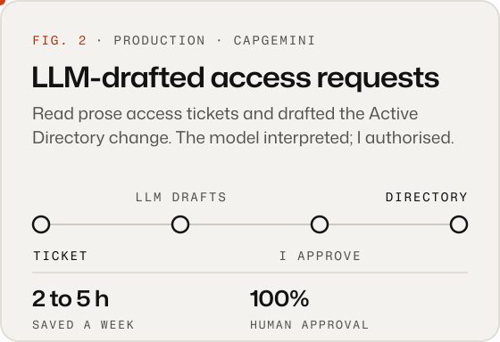</picture></a>

  <a href="https://github.com/Shubham-afk-del/Fraudulent-Claim-Detection"><picture><source media="(prefers-color-scheme: dark)" srcset="./assets/work-fraud-dark.svg"></picture></a>
  <a href="https://github.com/Shubham-afk-del/Employee-Retention-Prediction"><picture><source media="(prefers-color-scheme: dark)" srcset="./assets/work-retention-dark.svg"></picture></a>

  <a href="https://github.com/Shubham-afk-del/Delivery-Time-Prediction"><picture><source media="(prefers-color-scheme: dark)" srcset="./assets/work-delivery-dark.svg">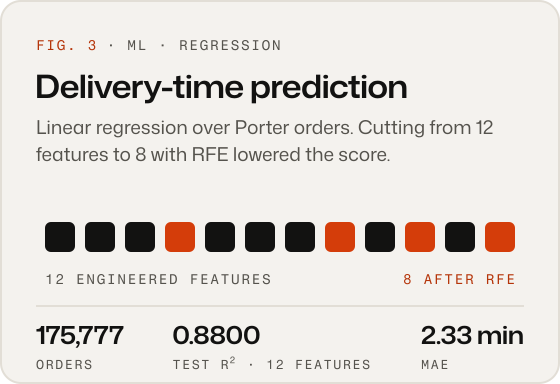</picture></a>
  <a href="https://github.com/Shubham-afk-del/NYC-Taxi-EDA"><picture><source media="(prefers-color-scheme: dark)" srcset="./assets/work-taxis-dark.svg"></picture></a>

  <a href="https://github.com/Shubham-afk-del/Farmers-Insurance-SQL"><picture><source media="(prefers-color-scheme: dark)" srcset="./assets/work-farmers-dark.svg"></picture></a>

<!-- LIVE:START -->
<a href="https://github.com/Shubham-afk-del/portfolio-assistant">
  <picture>
    <source media="(prefers-color-scheme: dark)" srcset="./assets/live-dark.svg?v=202610160956">
    
  </picture>
</a>
<!-- LIVE:END -->

<a href="https://shubham-kumar-singh.vercel.app/#experience">
  <picture>
    <source media="(prefers-color-scheme: dark)" srcset="./assets/experience-dark.svg">
    
  </picture>
</a>

<a href="https://shubham-kumar-singh.vercel.app/#skills">
  <picture>
    <source media="(prefers-color-scheme: dark)" srcset="./assets/skills-dark.svg">
    
  </picture>
</a>

<a href="https://shubham-kumar-singh.vercel.app/#education">
  <picture>
    <source media="(prefers-color-scheme: dark)" srcset="./assets/education-dark.svg">
    
  </picture>
</a>

<!-- CONTRIB:START -->
<a href="https://github.com/Shubham-afk-del">
  <picture>
    <source media="(prefers-color-scheme: dark)" srcset="./assets/contrib-dark.svg?v=202610160956">
    
  </picture>
</a>
<!-- CONTRIB:END -->

<a href="https://github.com/Shubham-afk-del/Shubham-afk-del">
  <picture>
    <source media="(prefers-color-scheme: dark)" srcset="./assets/colophon-dark.svg">
    
  </picture>
</a>
